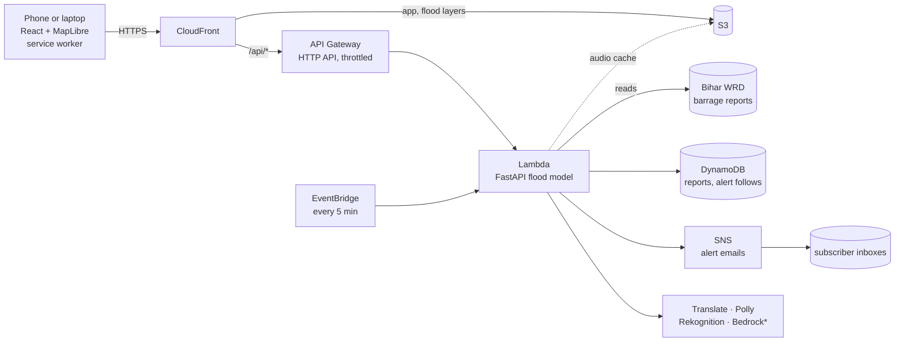

# Kosi Twin

**See the flood before it arrives.** Kosi Twin turns the Kosi river's official barrage reading into a village-by-village plan for
Bihar: which villages flood, when the water arrives, how deep it gets, when to leave and where to go. In English, Hindi, Bhojpuri and
Maithili, with voice, printable evacuation cards and email alerts.

**Live:** https://d34uuvdd8ofh55.cloudfront.net

> A planning aid built on a flood model, **not an official warning**. Follow the district administration's orders.

## What it does

| | |
|---|---|
| **Live river** | The newest official Bihar WRD *Koshi Barrage Gate Status Report* (discharge at Birpur, issued 10 AM and 3 PM), on a split-flap board that ticks to each new reading. If the department's server is unreachable the last stored reading is shown, marked as old. |
| **What if** | Drag the water gauge to ask "what if the river rose to...": the flood spreads across a 3D map and every village's risk and arrival time update. |
| **Every flood since 2018** | 31 floods (the barrage at 2 lakh cusecs or more) from the department's own readings, each replayable hour by hour. |
| **Village card** | Water arrives at..., deepest..., leave by..., the safest route to a dry school, hospital or raised road, a 72 h depth chart and a spoken advisory (Amazon Polly). |
| **Where people would go** | For the level on screen, how many people the plan sends to each destination (demand only; capacities are not in the data). |
| **Email alerts** | Follow a village; when the live reading climbs through a band that would flood it you get an email (AWS SNS, confirmed by link, unsubscribe in every message). |
| **Shareable links** | `#v=<village>&q=<lakh cusecs>&lang=hi` opens the same card at the same level, so a WhatsApp message lands on the exact plan. |
| **Works offline** | A service worker saves the app, the data last loaded, the flood layers and the map tiles you viewed. |
| **Flood Mirror** | Paints the predicted water onto a street photo, scaled from a door, a person or one tap on the ground. |
| **Honest check** | The info panel plots the model's river-height rule against the department's own downstream level readings and says what it shows. |
| **Printable card** | A one-page evacuation card per village for people with no signal or no phone. |

## How it fits together


\*Bedrock is wired in with automatic fallbacks; the account used for this build has no model access, so the features that would use it
(AI-written advisories, AI-painted water) use the built-in template and app-drawn water instead.

The flood model itself is precomputed on a laptop (AWS Open Data + OpenStreetMap, see below) and shipped inside the Lambda package, so
requests are fast and cheap. The five-minute schedule keeps the function warm, refreshes the live reading and sends alerts.

## Run it locally

```
# backend (needs the model artifacts in backend/data/out, see "Build the model")
cd backend
pip install -r requirements.txt
uvicorn kosi.api:app --reload            # http://127.0.0.1:8000
python -m pytest                          # 28 tests

# frontend
cd frontend
npm ci
npm run dev                               # http://127.0.0.1:5173 (proxies /api and /layers to :8000)
npx tsc -b && npx oxlint src              # type-check and lint
```

Without AWS credentials everything still runs: Translate, Polly, Rekognition and Bedrock fall back to built-in behaviour, and alerts are
written to a local file instead of being emailed ("demo mode" in the UI).

### Build the model (about 3 minutes)
```
pip install -r backend/requirements-prep.txt
cd backend/prep
python fetch_rasters.py    # Copernicus DEM + Meta HRSL population (AWS Open Data)
python fetch_osm.py        # villages, roads, Kosi channel, shelters (OpenStreetMap)
python build_model.py      # HAND flood model -> backend/data/out
python shrink_layers.py    # flood overlay tiles to 1560 px for the web (full-size originals are kept in data/out/layers_full)
python preview.py out.png 1 2.5 5
python bihar.py            # Bihar outline, districts, Kosi channel for the map
python translate_names.py  # Hindi village and shelter names (Amazon Translate)
python embankments.py      # ranks mapped dykes by people on low ground nearby
python fetch_barrage.py    # official barrage readings since 2018 (re-run to pick up new reports)
```

## API

| Endpoint | What it returns |
|---|---|
| `GET /api/live` | the newest official barrage reading, trend, last 60 days and a modelled 14-day trend |
| `GET /api/floods` | every flood since 2018 and the daily maximum series |
| `GET /api/scenario?discharge=4` | rise, flood overlay URL, people and villages affected, worst-hit villages |
| `GET /api/villages/{id}?discharge=4` (or `?replay=wrd:2024-09-29`) | village card: ETA, depth, leave-by, routes, facilities at risk, 72 h timeline |
| `GET /api/villages/{id}/advisory` and `/audio` | plain-language advisory and its spoken version |
| `GET /api/shelter-load?discharge=4` | where the plan sends people, by destination (demand only) |
| `GET /api/model-check` | the model's rise against the recorded downstream level, by discharge |
| `GET /api/replay/{name}` | frames for a recorded flood (`wrd:YYYY-MM-DD`) |
| `POST /api/alerts/subscribe`, `/api/alerts/test` | follow a village by email; send a test alert |
| `POST /api/mirror/detect`, `/api/mirror` | Flood Mirror: find a scale object; paint the water |
| `GET/POST /api/reports` | crowd reports of embankment seepage, cracks and breaches (shown as unverified) |

## Method and limits (read this)

- **Flood extent:** HAND (Height Above Nearest Drainage) along D8 flow paths to the Kosi on 90 m Copernicus DEM. A cell floods when the
  river rise exceeds its HAND and it connects to the channel.
- **Discharge to rise:** `rise = 2.4 * ((Q / 1 lakh)^0.6 - 1)`. It is set so the 2024 flood gives about a 5 m rise and is **not calibrated**.
  The honest check in the app compares it with the department's downstream level readings: below the barrage the recorded river rose
  about 0.55 m at 1.9 to 2.4 lakh cusecs, against 1.43 m from this rule. They are not the same measurement (a gauge just below the barrage
  against the river's height further down the plain), so it is a sanity check, not proof either way, but it suggests the flood depths
  here may run high. Treat them as cautious planning estimates until the rule is calibrated against gauges downstream.
- **Timing:** flood wave 5 km/h down the river, then 1 km/h across the fields. A rule of thumb, not measured travel times.
- **Official data:** the department's reports before 2018 show gate positions but no discharge, so the record starts in 2018. A few
  reports cannot be read and are skipped. The 14-day trend is the GloFAS model applied to today's real reading: a trend, not a forecast.
- **2024 figures:** news reports put the Sept 2024 peak near 6.6 lakh cusecs; the department's 10 AM and 3 PM readings, which the app shows and
  replays, top out at 6.13 lakh that week.
- **Shelters:** OpenStreetMap places have no capacities, so "where people would go" shows demand only.
- **Embankments:** only mapped stretches (OpenStreetMap, about 87 km); the colours show how many people live behind them, not where a break will happen.
- **Languages:** Bhojpuri and Maithili text needs review by native speakers.
- **Alerts:** a planning estimate from the model, not an official warning. Each address can follow 5 villages and the sign-up endpoint is
  capped per day so it cannot be used to mass-mail strangers.

## Deploy to AWS (us-east-1)

```
bash infra/deploy.sh      # builds the Lambda package, deploys the CloudFormation stack, uploads layers and the web app, invalidates CloudFront
```
Needs AWS CLI credentials and `backend/data/out`. Use an IAM user, not root credentials. Check `infra/.deploy.log` for the line
`deploy exit: 0`. Do not run two deploys at once. The stack (`infra/template.yaml`): Lambda, HTTP API, S3, CloudFront, DynamoDB, an SNS
topic for alerts, and a 5-minute EventBridge rule. The public API is throttled to 30 requests per second.

### Rough monthly cost
An estimate from AWS list prices for a demo-sized audience (about 1,000 visitors and 100,000 API calls a month); check current pricing and
set a billing alert in AWS Budgets.

| Service | Why it costs anything | About |
|---|---|---|
| Lambda (1.5 GB) and the 5-minute schedule | inside the always-free tier at this size | $0 |
| API Gateway (HTTP API) | $1 per million calls | $0.10 |
| CloudFront | first 1 TB out per month is free | $0 |
| S3 | under 1 GB (layers, audio cache, site) | under $0.05 |
| DynamoDB (on demand) | reports and alert follows | under $0.05 |
| SNS email | first 1,000 emails free | $0 |
| Polly, Translate, Rekognition | only when used (spoken advisories are cached in S3) | $0.50 to $3 |
| **Total** | | **about $1 to $5** |

## Credits
- Flood Mirror example scenes in `frontend/public/samples` are illustrations made by `backend/prep/make_samples.py`.
- Images in the splash screen, village card headers and info panel are AI-generated illustrations (labelled as such in the app), plus three press
  photographs and a basin map whose credits are still to be confirmed (see `frontend/public/img/`). Replace them with images you have the right to use.
- The split-flap counter is adapted from [Componentry](https://componentry.dev) (no licence is stated on the site; verify before production use).
- Data: Bihar Water Resources Department barrage reports, Copernicus DEM and Meta HRSL (AWS Open Data), OpenStreetMap, Open-Meteo / GloFAS, Sentinel-2 (EOX).
- Design guidance used: Apple Human Interface Guidelines and DESIGN.md (VoltAgent/awesome-design-md), taste-skill, and Vercel's Web Interface Guidelines.

## Licence
MIT, see [LICENSE](LICENSE). Third-party data keep their own licences (see Credits).
